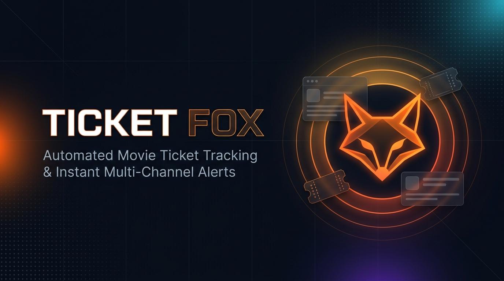
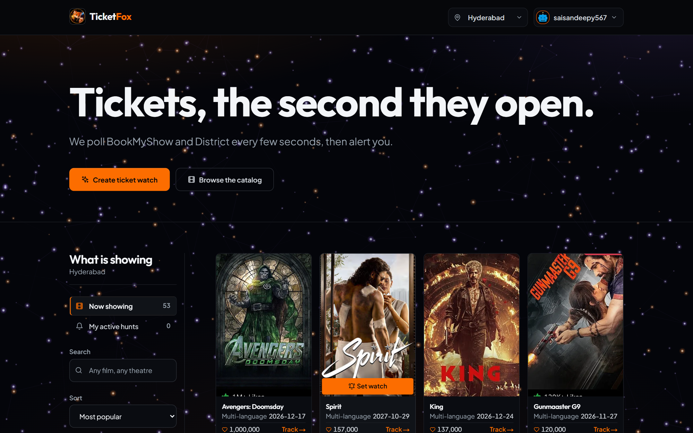
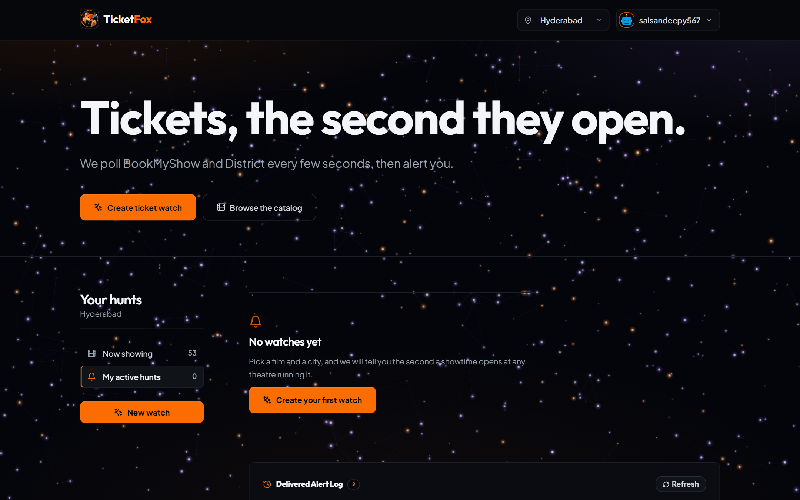
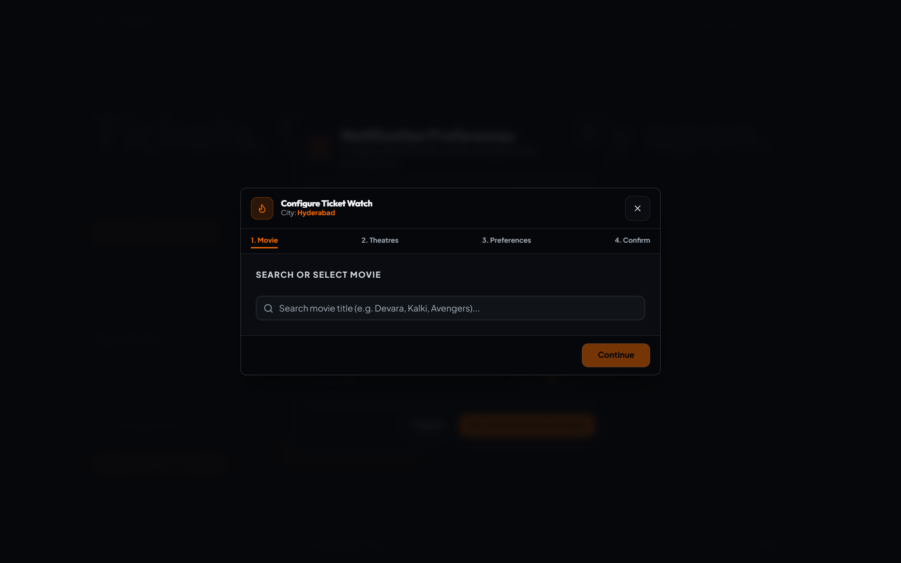
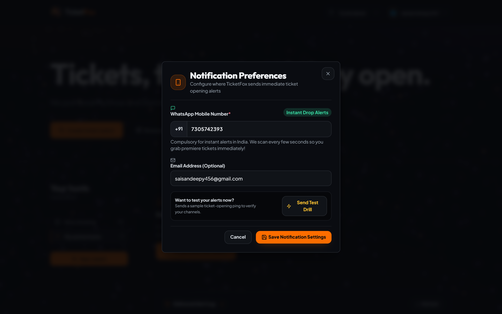
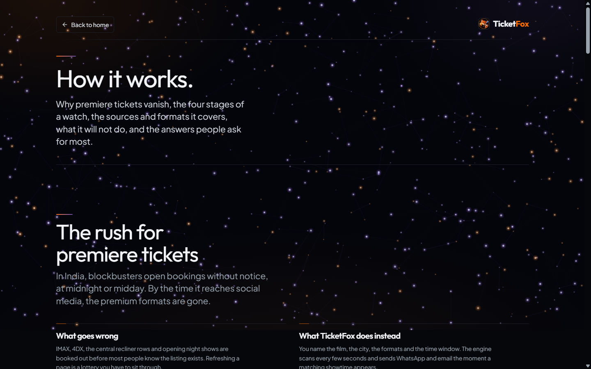
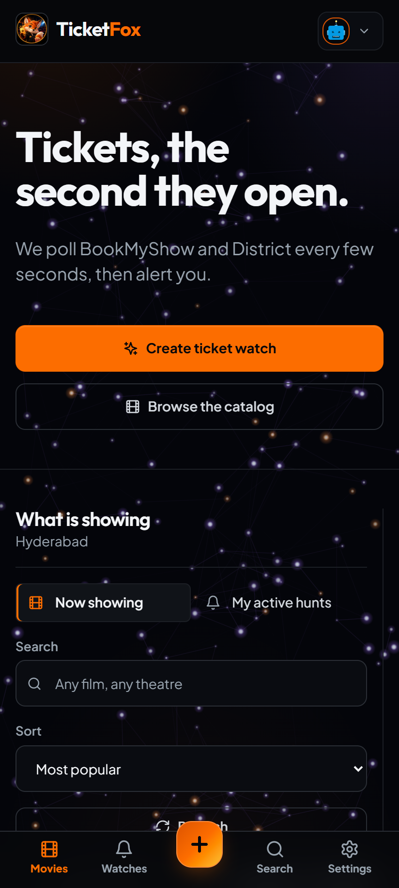
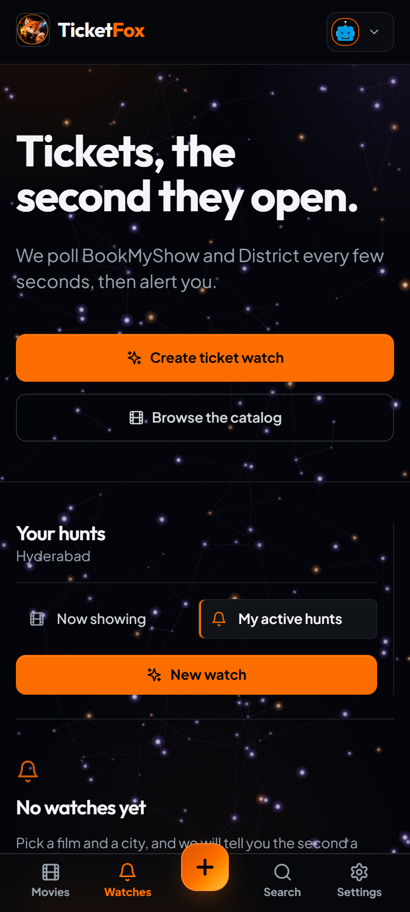
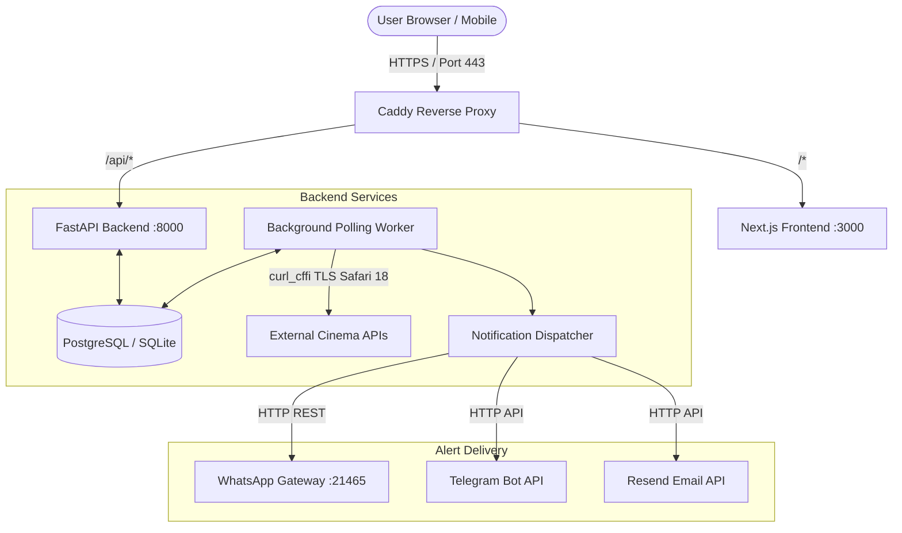

# Ticket Fox 🎟️🦊

> Real-time cinema ticket availability tracker and multi-channel notification platform.

[](https://nextjs.org/)
[](https://fastapi.tiangolo.com/)
[](https://www.python.org/)
[](https://www.typescriptlang.org/)
[](https://www.docker.com/)
[](LICENSE)

Live Deployment: [ticketfox.site](https://ticketfox.site)

---

## Overview

Ticket Fox monitors cinema ticket booking windows for high-demand movies across major ticketing platforms (BookMyShow, District) and alerts subscribers instantly via WhatsApp, Telegram, and Email before seats sell out.

### Visual Showcase



#### User Experience & Active Watch Management
| Live Discovery Dashboard | Active Ticket Hunts & Watches |
| :---: | :---: |
|  |  |

#### Alert Customization & Notification Settings
| Watch Creation Wizard | Notification Channels Configuration |
| :---: | :---: |
|  |  |

#### Administration & Mobile Experience
| How It Works & Architecture | Mobile Responsive Experience |
| :---: | :---: |
|  | <p align="center"> &nbsp; </p> |

---

## Core Capabilities

- **Deduplicated Polling Engine**: Consolidates active user watches by composite key `(source, movie_id, city)`. Instead of $N$ scrapers hitting ticketing endpoints for $N$ users, the background worker executes a single request per key and evaluates watch filters in memory.
- **Anti-Bot Resilience**: Uses `curl_cffi` to mimic browser TLS fingerprints (JA3 profile `safari18_0`), avoiding IP blocks and CDN bot challenges without heavy headless browser overhead.
- **Multi-Channel Dispatch Pipeline**:
  - **WhatsApp**: Integrated via a self-hosted WPPConnect gateway instance.
  - **Telegram**: Dedicated bot notifications.
  - **Email**: Transactional HTML alerts and verification emails via Resend.
- **Granular Watch Filters**: Set alerts for exact dates, preferred theater venues, experience formats (IMAX 2D/3D, 4DX, ScreenX), and time slots.
- **Modern User Experience**: Server-rendered Next.js 14 frontend with smooth animations, mobile-first design, search, and Google OAuth via Firebase Authentication.
- **Admin Control Plane**: Built-in administrative dashboard for reviewing telemetry, manual cycle sweeps, and broadcast announcements.

---

## System Architecture



---

## Directory Structure

```text
ticket-fox-web/
├── backend/
│   ├── app/
│   │   ├── engine/           # Scraping adapters, city catalogs, show filters
│   │   ├── database/         # Async SQLAlchemy models & repository
│   │   ├── notifications.py  # Alert rendering & multi-channel dispatcher
│   │   ├── whatsapp.py       # WhatsApp gateway client
│   │   ├── worker.py         # Deduplicated interval polling worker
│   │   └── main.py           # FastAPI routes & endpoints
│   ├── Dockerfile
│   └── requirements.txt
├── frontend/
│   ├── app/                  # Next.js 14 App Router (Discover, FAQ, Admin)
│   ├── components/           # UI cards, modals, search, navigation
│   ├── lib/                  # Backend API clients, auth helpers
│   ├── Dockerfile
│   └── package.json
├── deploy/                   # Cloud deployment automation scripts
├── docs/                     # Setup, EC2 guides, and screenshots
│   └── images/               # Repository visual assets
├── whatsapp-gateway/         # Containerized WPPConnect service
├── docker-compose.yml        # Production multi-container orchestration
└── Caddyfile                 # Automatic TLS reverse proxy configuration
```

---

## Getting Started

### Prerequisites

- Node.js 18+ & npm
- Python 3.11+
- Docker & Docker Compose (for containerized setup)
- Firebase Project (for Google Authentication)

### Local Development Setup

#### 1. Backend Setup

```bash
cd backend
python -m venv venv

# On Linux/macOS:
source venv/bin/activate
# On Windows:
.\venv\Scripts\activate

pip install -r requirements.txt
cp .env.example .env
# Edit .env with your local settings (SQLite works out of the box)
python run.py
```

The API will be available at `http://localhost:8000`.

#### 2. Frontend Setup

```bash
cd frontend
npm install
cp .env.local.example .env.local
# Add your Firebase credentials to .env.local
npm run dev
```

The web application will be available at `http://localhost:3000`.

---

## Production Deployment (Docker Compose)

The repository includes a ready-to-use Docker Compose setup combining the web client, API worker, WhatsApp gateway, and Caddy with automatic SSL certificates.

1. Configure root `.env`:
   ```bash
   cp .env.example .env
   ```
2. Set your custom domain (`DOMAIN=ticketfox.example.com`) and keys.
3. Build and launch all services:
   ```bash
   docker compose up -d --build
   ```

For detailed cloud instructions (AWS EC2 / VPS), consult [`docs/DEPLOY-EC2.md`](docs/DEPLOY-EC2.md).

---

## Testing

```bash
# Backend test suite (48+ unit and integration tests)
cd backend
python -m pytest tests -q

# Frontend type verification
cd frontend
npx tsc --noEmit
```

---

## License

This project is licensed under the MIT License. See [LICENSE](LICENSE) for details.
