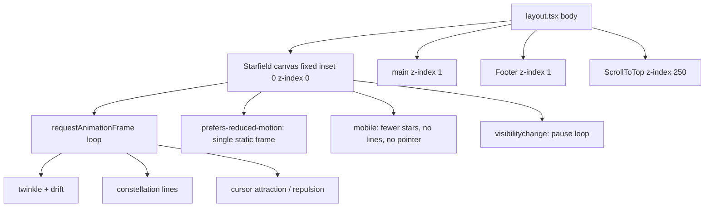
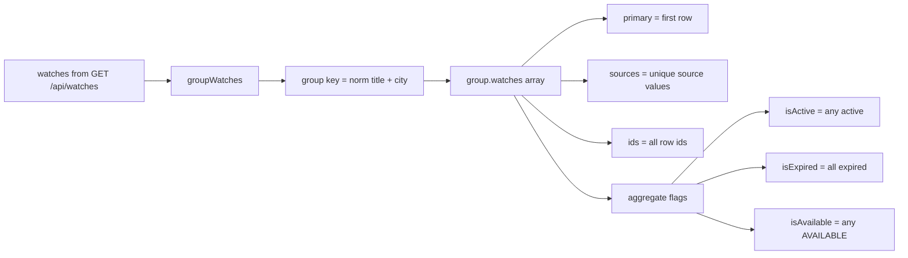

# TicketFox Frontend Improvements — Implementation Plan

Four independent changes. Items 1, 2 and 4 are frontend-only. Item 3 is frontend-only by decision: the backend keeps creating two `Watch` rows, and the UI groups them into one card.

---

## 1. Movie detail: one big "Track Now" button

**Current state** — [`MovieDetailModal.tsx`](frontend/components/MovieDetailModal.tsx:238) renders `.detail-alert-banner` containing:

- `.detail-alert-icon` with a `Bell`
- `.detail-alert-title` — "TicketFox Live Availability Engine"
- `.detail-alert-text` — either the active-watch count or "Be the first to set alerts for early showtimes & premiere tickets in {city}."
- `.detail-alert-actions` with a Share button (`handleCopyShareLink`) and a "Track Tickets" button

**Target** — a single full-width primary CTA reading **Track Now**, no banner chrome, no Share.

### Changes

| File | Change |
|---|---|
| [`MovieDetailModal.tsx`](frontend/components/MovieDetailModal.tsx:238) | Delete the whole `.detail-alert-banner` block. Replace with one `<button className="detail-track-cta">` that runs `onClose(); onStartWatch(movie);` |
| [`MovieDetailModal.tsx`](frontend/components/MovieDetailModal.tsx:39) | Remove `copiedShare` state, `handleCopyShareLink`, and the `activeWatchCount` derivation (all become dead) |
| [`MovieDetailModal.tsx`](frontend/components/MovieDetailModal.tsx:4) | Drop `Share2` and `Check` from the lucide import list. Keep `Bell` — it is still used by the footer "Start Ticket Alert" button at line 433 |
| [`globals.css`](frontend/app/globals.css:5769) | Delete `.detail-alert-banner`, `.detail-alert-main`, `.detail-alert-icon`, `.detail-alert-title` (+ its media query), `.detail-alert-text` (+ its media query), `.detail-alert-strong`, `.detail-alert-actions` (+ its media query), `.detail-share-btn`, `.detail-share-btn:hover`, `.detail-share-btn.is-copied` |
| [`globals.css`](frontend/app/globals.css:5872) | Keep `.detail-track-btn` (still referenced by the reduced-motion block at line 6167) or rename it to `.detail-track-cta` and update that reference. Preferred: rename to `.detail-track-cta` and restyle |
| [`globals.css`](frontend/app/globals.css:6160) | Update the `prefers-reduced-motion` selector from `.detail-track-btn:active` to `.detail-track-cta:active` |

### New CSS shape

```css
.detail-track-cta {
  display: flex;
  align-items: center;
  justify-content: center;
  gap: var(--space-xs);
  width: 100%;
  min-height: 3.25rem;
  padding: var(--space-sm) var(--space-lg);
  border-radius: var(--radius-card);
  border: 1px solid var(--color-accent-hover);
  background: var(--color-accent);
  color: var(--color-accent-ink);
  font-family: var(--font-display);
  font-size: var(--text-base);
  font-weight: 800;
  letter-spacing: 0.01em;
  cursor: pointer;
  box-shadow: 0 12px 32px -16px oklch(0.70 0.20 48 / 0.6);
  transition: background-color var(--dur-micro) var(--ease-out),
              transform var(--dur-micro) var(--ease-out);
}
.detail-track-cta:hover { background: var(--color-accent-hover); }
.detail-track-cta:active { transform: scale(0.985); }
```

---

## 2. Global interactive starfield

**Constraint confirmed:** `package.json` has no `tsParticles` and no other particle library. Adding one is out of scope, so this is a hand-written `<canvas>` component. Zero new dependencies.

### Architecture



### New file — `frontend/components/Starfield.tsx`

`"use client"` component, no props.

**Setup**
- One `<canvas ref>` with `aria-hidden="true"` and `className="starfield-canvas"`.
- `useEffect` on mount: read `window.matchMedia("(prefers-reduced-motion: reduce)")` and `window.matchMedia("(max-width: 48rem)")`.
- Size the canvas to `window.innerWidth/innerHeight` multiplied by `Math.min(window.devicePixelRatio || 1, 2)` — the DPR cap is the main GPU guard. Set `canvas.style.width/height` in CSS pixels and `ctx.scale(dpr, dpr)`.

**Star model** — a plain array of objects, allocated once per resize:

```ts
type Star = {
  x: number; y: number;        // base position, CSS px
  ox: number; oy: number;      // current offset from cursor force
  r: number;                   // 0.4 – 1.6 px
  baseAlpha: number;           // 0.25 – 0.9
  twinklePhase: number;        // random 0..2π
  twinkleSpeed: number;        // 0.0004 – 0.0012
  driftX: number; driftY: number; // ±0.02 px/frame
  hue: number;                 // 0 = white, 1 = warm accent, 2 = cool
};
```

**Counts**
- Desktop: `Math.round((w * h) / 9000)` clamped to `120..320` — "hundreds of stars" without flooding a 4K panel.
- Mobile (`max-width: 48rem`): `Math.round((w * h) / 26000)` clamped to `40..90`.

**Per-frame draw** (single `requestAnimationFrame` loop, `ctx.clearRect` then one pass):

1. Advance `twinklePhase` by `twinkleSpeed * dt`; `alpha = baseAlpha * (0.55 + 0.45 * sin(phase))`.
2. Advance base position by `driftX/driftY`; wrap around the edges so stars never pop.
3. Cursor force: compute `dx = star.x - pointer.x`, `dy = star.y - pointer.y`, `dist2 = dx*dx + dy*dy`. Inside `RADIUS = 140px`, apply a **repulsion** offset scaled by `(1 - dist/RADIUS)^2` and eased toward the target with `ox += (targetOx - ox) * 0.08` — this is what makes it smooth instead of jumpy. Outside the radius the offset eases back to 0.
4. Draw the star as a filled arc with `globalAlpha = alpha`. Stars with `r > 1.2` get a second, larger, low-alpha arc for the glow.
5. Constellation lines: only when `!isMobile`. For each star, compare against the next ~12 stars in the array (bounded neighbour scan, not O(n²) over the whole field). If `dist < 110`, stroke a line with `globalAlpha = 0.10 * (1 - dist/110)`. Cap total lines per frame at ~180 to keep the stroke count flat.

**Guards**
- `prefers-reduced-motion: reduce` → draw exactly one frame with no twinkle, no drift, no pointer force, and never call `requestAnimationFrame`.
- `document.visibilitychange` → cancel the rAF when hidden, restart when visible.
- `resize` → debounced (150 ms) re-init of the star array and canvas size.
- Cleanup → `cancelAnimationFrame`, remove `resize`, `pointermove`, `pointerleave`, `visibilitychange` listeners.
- Pointer tracking uses `pointermove` on `window` (not the canvas) so the effect still reacts when the cursor is over content, since the canvas is `pointer-events: none`.

### CSS — `globals.css`

```css
.starfield-canvas {
  position: fixed;
  inset: 0;
  width: 100%;
  height: 100%;
  z-index: 0;
  pointer-events: none;
  opacity: 0.9;
}
```

### Shell changes — `globals.css` + `layout.tsx`

- [`.app-shell`](frontend/app/globals.css:2959) currently paints `background: var(--surface-canvas)`, which would hide the canvas. Change it to `background: transparent` and move the base colour to `body` (already `var(--color-paper)` at line 16) so the page keeps its obsidian base.
- Add `position: relative; z-index: 1;` to the `main` and `footer` wrappers so content sits above the canvas. Simplest: add a `.app-shell > main, .app-shell > footer { position: relative; z-index: 1; }` rule.
- [`layout.tsx`](frontend/app/layout.tsx:52) — mount `<Starfield />` as the first child of `<body>`, before `<main>`. Mounted once, so every route inherits it with no duplication.

**Readability:** the canvas is behind everything and the existing surfaces (`.panel`, `.watch-card`, `.catalog-rail`, `.mast`) already have opaque backgrounds, so text contrast is unchanged. Star alpha stays under 0.9 and line alpha under 0.10.

---

## 3. One Active Hunts card for the BMS + District pair

**Root cause** — [`WatchWizardModal.tsx`](frontend/components/WatchWizardModal.tsx:328) defaults `watchPlatform` to `"both"`, and [`_create_dual_watch()`](backend/app/main.py:288) then inserts two rows: a primary watch and a companion on the other platform. The worker keys polling on `(source, movie_id, region_code)` ([`poll_key()`](backend/app/worker.py:154)), so the two rows are genuinely two poll targets. **The backend stays untouched** — the UI groups them.

### Grouping rule

Two watches belong to the same group when **normalized title + city** match. Title normalization: lowercase, strip non-alphanumerics, collapse whitespace. This is deliberately title-based rather than id-based, because the BMS id and the District id/slug differ for the same film.



### New file — `frontend/lib/watches.ts`

```ts
export type WatchGroup = {
  key: string;
  watches: any[];
  primary: any;
  ids: number[];
  sources: string[];      // e.g. ["bookmyshow", "district"]
  isActive: boolean;      // any row active
  isExpired: boolean;     // every row expired
  isAvailable: boolean;   // any row AVAILABLE
  isPaused: boolean;      // no row active and not all expired
};

export function groupWatches(watches: any[]): WatchGroup[];
```

Ordering: preserve the order of first appearance so the list does not reshuffle between polls.

### `WatchCard.tsx` refactor

- Props change from `watch: any` to `group: WatchGroup` (or keep `watch` and add `watches`; cleaner to switch to `group`).
- Every `watch.x` read becomes `group.primary.x` for display fields (title, poster, city, date filter, time window, formats, max price, timestamps).
- State derivation switches to the aggregate flags.
- The single source tag at [line 212](frontend/components/WatchCard.tsx:212) becomes a row of badges, one per entry in `group.sources`, labelled `BMS` / `DISTRICT`.
- Actions fan out over `group.ids`:
  - `onTogglePause(group.ids, group.isActive)`
  - `onDelete(group.ids)`
  - `onTestDrill(group.ids)`
  - `onToggleSelect(group.ids)`
- Batch checkbox `checked` = every id in `group.ids` is in the selection set.

### `page.tsx` changes

- Derive `const watchGroups = useMemo(() => groupWatches(watches), [watches])`.
- Render `watchGroups.map((g) => <WatchCard key={g.key} group={g} … />)`.
- Widen the handlers to accept `string[] | number[]` and loop the existing single-id body over each id:
  - [`handleTogglePause`](frontend/app/page.tsx:290)
  - [`handleDeleteWatch`](frontend/app/page.tsx:308)
  - [`handleTestDrill`](frontend/app/page.tsx:369)
  - [`handleToggleSelectWatch`](frontend/app/page.tsx:325)
- [`handleBatchDelete`](frontend/app/page.tsx:345) already posts an id array — no change beyond the selection set now holding every id of a selected group.
- [`hunts-bar`](frontend/app/page.tsx:803) counts switch from `watches.length` to `watchGroups.length`, and the active/expired counts derive from the group flags. The "Select all" comparison at line 822 compares against `watchGroups.length`.

### CSS

Add a `.watch-card-sources` flex row with `gap: var(--space-2xs)` and `flex-wrap: wrap` so two source badges sit neatly next to the status badge.

---

## 4. Scroll-to-top button

### New file — `frontend/components/ScrollToTop.tsx`

`"use client"`, no props.

- `useState(false)` for `visible`.
- `useEffect`: `scroll` listener (passive) sets `visible = window.scrollY > 480`.
- Click → `window.scrollTo({ top: 0, behavior: prefersReducedMotion ? "auto" : "smooth" })`.
- Renders `<button className={`scroll-top${visible ? " is-visible" : ""}`} aria-label="Scroll back to top">` with a `ChevronUp` / `ArrowUp` from lucide.
- Hidden from the tab order when not visible via `tabIndex={visible ? 0 : -1}` and `aria-hidden={!visible}`.

### CSS

```css
.scroll-top {
  position: fixed;
  right: var(--space-md);
  bottom: var(--space-md);
  z-index: 250;                 /* above content, below --z-modal 400 */
  display: flex;
  align-items: center;
  justify-content: center;
  width: 2.75rem;
  height: 2.75rem;
  border-radius: 999px;
  border: 1px solid var(--border-strong);
  background: var(--surface-overlay);
  color: var(--text-secondary);
  box-shadow: var(--shadow-card);
  cursor: pointer;
  opacity: 0;
  transform: translateY(0.5rem);
  pointer-events: none;
  transition: opacity var(--dur-short) var(--ease-out),
              transform var(--dur-short) var(--ease-out),
              color var(--dur-micro) var(--ease-out);
}
.scroll-top.is-visible { opacity: 1; transform: none; pointer-events: auto; }
.scroll-top:hover { color: var(--color-accent); border-color: var(--color-accent); }

@media (max-width: 48rem) {
  .scroll-top { bottom: calc(4.5rem + env(safe-area-inset-bottom) + var(--space-sm)); }
}

@media (prefers-reduced-motion: reduce) {
  .scroll-top { transition: none; }
}
```

The mobile offset clears the fixed bottom nav, which already reserves `4.5rem + safe-area` on `.app-shell` at [line 2971](frontend/app/globals.css:2971).

Mount once in [`layout.tsx`](frontend/app/layout.tsx:52) next to `<Starfield />`.

---

## Verification

1. `cd frontend && npx tsc --noEmit`
2. `npx next lint --file components/MovieDetailModal.tsx --file components/WatchCard.tsx --file components/Starfield.tsx --file components/ScrollToTop.tsx --file lib/watches.ts --file app/page.tsx --file app/layout.tsx`
3. `curl -s http://localhost:3000/ | findstr "starfield-canvas scroll-top"` — confirms both mount points render.
4. `curl -s http://localhost:3000/_next/static/css/app/layout.css | findstr "detail-track-cta watch-card-sources scroll-top starfield-canvas"` — confirms the new CSS compiled.
5. Manual: open a movie detail, confirm only the Track Now button remains; create a "both" watch and confirm one card with two source badges; scroll down and confirm the arrow appears and returns to top.

## Files touched

| File | Type |
|---|---|
| `frontend/components/MovieDetailModal.tsx` | edit |
| `frontend/components/WatchCard.tsx` | edit |
| `frontend/components/Starfield.tsx` | new |
| `frontend/components/ScrollToTop.tsx` | new |
| `frontend/lib/watches.ts` | new |
| `frontend/app/page.tsx` | edit |
| `frontend/app/layout.tsx` | edit |
| `frontend/app/globals.css` | edit |

No backend files change.
