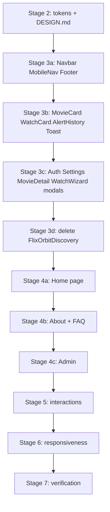

# TicketFox Frontend Transformation — Implementation Proposal

Status: **Awaiting approval. No source code has been modified.**

---

## 0. Confirmed Scope Decisions

| Decision | Resolution |
|---|---|
| Two parallel styling systems | **Unify on the semantic CSS token system.** All Tailwind utility literals in components (`bg-obsidian-950`, `text-slate-400`, `glass-card`, `glass-panel`, `transition-all`, `border-white/8`, etc.) are migrated to semantic classes defined in `globals.css`. |
| Violet secondary accent | **Add it.** New tokens in `tokens.css`; used sparingly for secondary emphasis (secondary CTA, informational states, focus-adjacent highlights, admin "operate" mode). Amber/orange remains the primary brand accent. |
| Orphaned `FlixOrbitDiscovery.tsx` | **Remove it.** Confirmed unused (not imported by any route). |
| Dev server + backend | User will start both for browser verification (Stages 1, 6, 7). |

---

## 1. Design Direction (locked)

- **Archetype:** Cinema Command Center — dark-first, deep charcoal, cinematic.
- **Primary accent:** cinematic amber/orange (existing `--color-accent`, fox-500 `oklch(0.70 0.20 48)`).
- **Secondary accent (new):** restrained violet — `--color-accent-2` ≈ `oklch(0.62 0.19 295)`, with hover/quiet/ink variants. Used for secondary emphasis only, never competing with amber.
- **Typography:** Outfit (display/headings) + Plus Jakarta Sans (body) — already wired via `next/font/google`.
- **Layout:** spacious, generous rhythm, strong hierarchy, no cramped grids.
- **Motion:** balanced, physical, `cubic-bezier(0.16, 1, 0.3, 1)`, respects `prefers-reduced-motion`.
- **Responsive:** desktop / tablet / mobile, no horizontal overflow, ≥44px touch targets.

---

## 2. Stage 2 — Design System (tokens + docs)

### 2.1 `frontend/app/tokens.css` additions
Add a violet secondary ramp and a few missing semantic tokens:

```css
/* Secondary accent — restrained violet */
--color-accent-2:        oklch(0.62 0.19 295);
--color-accent-2-hover:  oklch(0.68 0.19 295);
--color-accent-2-quiet:  oklch(0.62 0.19 295 / 0.14);
--color-accent-2-ink:    oklch(0.98 0.01 295);

/* Semantic surface aliases (so components stop using raw obsidian-*) */
--surface-canvas:  var(--color-paper);
--surface-raised:  var(--color-paper-2);
--surface-sunken:  var(--color-paper-3);
--surface-overlay: var(--color-paper-4);

/* Semantic text aliases */
--text-primary:   var(--color-ink);
--text-secondary: var(--color-ink-2);
--text-muted:     var(--color-muted);

/* Border aliases */
--border-strong: var(--color-rule);
--border-soft:   var(--color-rule-soft);
```

### 2.2 `frontend/app/globals.css` — new semantic component classes
Add a small, documented set so components never need Tailwind literals:

- `.surface` / `.surface-raised` / `.surface-sunken` / `.surface-overlay`
- `.text-primary` / `.text-secondary` / `.text-muted`
- `.border-strong` / `.border-soft`
- `.badge` + `.badge--accent` / `.badge--accent-2` / `.badge--success` / `.badge--warning` / `.badge--danger` / `.badge--muted`
- `.icon-btn` (replaces ad-hoc icon buttons)
- `.modal-backdrop` / `.modal-panel` / `.modal-head` / `.modal-body` / `.modal-foot` (shared modal shell)
- `.toast` / `.toast--success` / `.toast--error` / `.toast--info`
- `.skeleton` (replaces `animate-pulse` literals)
- `.field-label` / `.field-input` / `.field-hint` / `.field-error`
- `.stack-*` spacing helpers only where genuinely reusable

### 2.3 `frontend/DESIGN.md` update
Document: violet secondary accent + when to use it, the semantic class inventory, the "no Tailwind color literals in components" rule, motion tokens, responsive breakpoints.

---

## 3. Stage 3 — Global Components Migration

Each component is migrated from Tailwind literals to semantic classes. **No behavior, props, or API calls change.**

| Component | Current literals to remove | Target |
|---|---|---|
| `Navbar.tsx` | already mostly semantic (`.nav*`) — audit + polish only | `.nav*` |
| `MobileNav.tsx` | `bg-obsidian-*`, `text-slate-*`, `transition-all`, `border-white/*` | `.mobile-nav*` semantic classes |
| `Footer.tsx` | already `.mast*` — audit only | `.mast*` |
| `MovieCard.tsx` | `bg-obsidian-*`, `text-slate-*`, `text-amber-*` | `.card`, `.badge*`, `.text-*` |
| `WatchCard.tsx` | `glass-card`, `bg-obsidian-*`, `text-slate-*`, emoji status icons, `transition-all` | `.watch-card`, `.badge*`, lucide icons |
| `AlertHistory.tsx` | `glass-panel`, `bg-obsidian-900/60`, `border-white/8` | `.panel`, `.badge*` |
| `Toast.tsx` | `bg-obsidian-*`, `text-slate-*`, `transition-all` | `.toast*` |
| `AuthModal.tsx` | `text-slate-*`, `bg-obsidian-*`, `border-white/*` | `.modal-*`, `.field-*` |
| `SettingsModal.tsx` | `text-slate-*`, `text-amber-*` | `.modal-*`, `.field-*` |
| `MovieDetailModal.tsx` | `bg-obsidian-*`, `text-slate-*`, `text-amber-*` | `.modal-*`, `.badge*` |
| `WatchWizardModal.tsx` | `text-amber-*`, `text-slate-*`, `bg-obsidian-*` | `.modal-*`, `.field-*`, `.badge*` |
| `TicketFoxLogo.tsx` | audit only | — |
| `UserAvatar.tsx` | audit only | — |
| `FlixOrbitDiscovery.tsx` | **DELETE** | — |

**Emoji → lucide icons** in `WatchCard` status badges (📅 etc.) and anywhere else emoji are used as UI icons.

---

## 4. Stage 4 — Page Redesign

### 4.1 Home (`app/page.tsx`, 1233 lines)
- **Hero (Counter posture):** refine composer (film input, city select, create button, browse link) + watch-preview card. Stronger hierarchy, violet used only for the secondary "browse" affordance.
- **Catalog:** rail (filters, search, sort, refresh) + grid (`MovieCard`). Tighten spacing, unify card hover/focus, skeleton loading.
- **Hunts tab:** `WatchCard` list, batch actions, `AlertHistory`. Empty state redesign.
- **Bands:** lifecycle steps, spec table, comparison table, questions, close — unify table styling, spacing rhythm.
- Preserve all state, handlers, polling, chime, modals, toasts.

### 4.2 About (`app/about/page.tsx`, 191 lines)
- Bands: problem, how it operates, guarantees table, creator contact, close. Unify with home band styling.

### 4.3 FAQ (`app/faq/page.tsx`, 170 lines)
- Accordion (7 items) — fix hero overflow, unify accordion motion, contact row, close.

### 4.4 Admin (`app/admin/page.tsx`, 1075 lines)
- Gate screen, 4 tabs (overview, failing_keys, broadcasts, users_watches), tables, forms.
- Violet accent used here as the "operate mode" secondary to distinguish admin from consumer surface.
- Preserve `X-Admin-Key` header flow, all handlers, polling.

---

## 5. Stage 5 — Interactions

- Replace all `transition-all` with specific property transitions.
- Standardize hover/active/focus-visible states via semantic classes.
- Loading: skeletons (`.skeleton`) for catalog, watches, alerts, admin tables.
- Empty states: consistent `.empty-state` component pattern.
- Dropdowns/dialogs: consistent open/close motion (fade + scale, `--dur-short`, `--ease-out`).
- Toasts: consistent enter/exit.
- `prefers-reduced-motion`: all motion disabled/reduced (already partially in `base.css`; extend).

---

## 6. Stage 6 — Responsiveness

- Test at 1440 / 1024 / 768 / 390 widths.
- Fix horizontal overflow (known: FAQ hero).
- Touch targets ≥44px (MobileNav, icon buttons, batch checkboxes).
- Nav states: desktop dropdown, mobile bottom bar, admin rail collapse.
- Tables: horizontal scroll wrappers where needed (admin already has `.console-table-wrap`).

---

## 7. Stage 7 — Verification

- Playwright: visit `/`, `/about`, `/faq`, `/admin` at desktop + mobile; screenshot before/after.
- Exercise: search, city change, create watch wizard, settings save, auth modal, movie detail, batch delete, admin gate + tabs.
- Chrome DevTools: console errors, network failures, Lighthouse a11y.
- `npx tsc --noEmit` + `npm run build`.
- Confirm backend integration intact (no API contract changes).

---

## 8. Build Order (small verifiable batches)



Each batch is tested in the browser before the next begins.

---

## 9. Guardrails (from the brief)

- No mock data; no API contract changes; no backend logic changes.
- No feature deletion; no placeholder pages; no homepage-only redesign.
- No unnecessary dependencies.
- No completion claim without browser testing.
- All data access stays through `lib/api.ts`, `lib/cities.ts`, `lib/admin.ts`, `lib/phone.ts`, `lib/tmdb.ts`.
